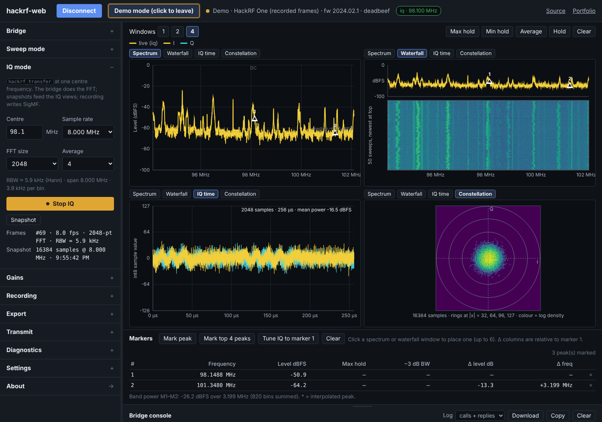

# hackrf-web

A quick bench page for the HackRF One. Run a small bridge on the computer the
board is plugged into, open the page, and you have live spectrum and waterfall
across any span to 6 GHz, IQ at one centre frequency with the FFT done locally,
IQ snapshots as time-domain and constellation views, IQ recording to SigMF, and
a transmit section that stays locked unless you unlock it on the bridge.

**Use it:** https://lc-linkous.github.io/hackrf-web/

```sh
pip install hackrf-web
hackrf-web           # starts the bridge, prints a token, opens the page
```

The page has a *Try without hardware* mode that needs no bridge: it replays
frames computed from a real HackRF One recording (the FM band at 8 Msps that
ships with the library's tests).

<p align="center"></p>

This is the browser companion to the
[hackRF_python](https://github.com/LC-Linkous/hackRF_python) library
(`hackrfpy`). It is deliberately **not** the whole library: the page covers
the plug-in-and-look workflow, and scripts cover everything else.

## How it fits together

The HackRF is not a serial device, so unlike
[nanovna-web](https://github.com/LC-Linkous/nanovna-web) and
[tinysa-web](https://github.com/LC-Linkous/tinysa-web) the browser cannot talk
to it directly. A Python **bridge** stands in:

```
          GitHub Pages (or the bridge's own copy at http://127.0.0.1:8765/)
   ┌──────────────────────────────────────────────────────────────────┐
   │ hackrf-web page                                                  │
   │   js/device/bridge-link.js   WebSocket client, binary frames     │
   │   js/device/hackrf.js        method names follow hackrfpy        │
   │   js/plot/  js/ui/           windows, markers, recorder, console │
   └───────────────┬──────────────────────────────────────────────────┘
                   │  ws://127.0.0.1:8765/?token=…      (PROTOCOL.md)
                   │  JSON calls and events; spectrum + IQ as binary
   ┌───────────────▼──────────────────────────────────────────────────┐
   │ hackrf-web bridge   (pip install hackrf-web → `hackrf-web`)      │
   │   session manager   idle ─ sweep ─ iq ─ tx, one child at a time │
   │   frames.py         sweep stitching · Hann FFT · int8 re-encode  │
   │   recorder          int8 .iq + .sigmf-meta, time cap, disk check │
   └───────────────┬──────────────────────────────────────────────────┘
                   │  hackrfpy  (unmodified, from PyPI)
   ┌───────────────▼──────────────────────────────────────────────────┐
   │ hackrf-tools        hackrf_info · hackrf_sweep · hackrf_transfer │
   └───────────────┬──────────────────────────────────────────────────┘
                   │  USB
                HackRF One
```

Reading it top to bottom:

- **The page never sees a binary, an argv, or a raw stream it did not ask
  for.** It calls `session.start`, `iq.snapshot`, `record.start`; the bridge
  turns those into `hackrfpy` calls (`sweep`, `open_receiver`,
  `estimate_capture`, `write_sigmf_meta`, `transmit_cw`), and `hackrfpy` runs
  the tools. Every layer validates: the page against `models.js`, the bridge
  against the protocol, the library against its envelope.
- **The FFT runs in the bridge.** 20 Msps of int8 IQ is 40 MB/s; what crosses
  the socket is one spectrum frame per 80 ms and, on request, one IQ block.
  The page shows the frame rate and how many blocks it did not get to see.
- **Recordings are written by the bridge**, on the same decoded blocks the
  FFT uses, re-encoded to int8 exactly (hackrfpy normalises by 128, so
  `round(x·128)` is lossless). A time cap is mandatory and the disk is
  checked first; display blocks may be dropped, recorded bytes never are.
- **Files are the hand-off to Python.** A recording is interleaved int8 with
  a SigMF sidecar, which `hackrfpy.load_iq` and `read_sigmf_meta` read back;
  the page's frame CSVs are `Frequency_Hz,Level_dBFS`.

`hackrf-web --fake` runs the whole bridge against a simulated board — every
state transition is real, only the samples are synthesised — and
`hackrf-web --doctor` prints hackrfpy's preflight report and exits.

### Where the page is served from

The page is static and identical in both places:

- **GitHub Pages** (default). `hackrf-web` opens
  `https://lc-linkous.github.io/hackrf-web/#bridge=127.0.0.1:8765&token=…`.
  Chrome and Firefox let an https page open a WebSocket to loopback; the
  bridge answers Chrome's private-network preflight. The token rides in the
  URL fragment, which never leaves the browser.
- **The bridge itself** (`hackrf-web --local-page`, or just open
  `http://127.0.0.1:8765/`). Same origin, no mixed content, works in Safari
  and offline, and the page version always matches the bridge. Use this if
  the Pages route is blocked by a browser policy.

Pages updates on every push; the bridge updates with `pip install -U
hackrf-web`. The handshake carries both versions and the page says if they
disagree.

## Layout

```
┌──────────────────────────────────────────────────────────────────┐
│ hackrf-web  [Connect to bridge] [Demo]  ● status  [iq · 98.1 MHz] │
├────────────┬─────────────────────────────────────────────────────┤
│ Bridge     │ Windows [1][2][4]        Max  Min  Avg  Hold  Clear │
│  address   │ ┌ Spectrum ─────────────┐ ┌ Waterfall ───────────┐   │
│  token     │ │   dBFS vs frequency   │ │   rolling history    │   │
│  preflight │ │   DC marker, median   │ │                      │   │
│ ────────── │ └───────────────────────┘ └──────────────────────┘   │
│ Sweep mode │ ┌ IQ time ──────────────┐ ┌ Constellation ───────┐   │
│  band      │ │   I and Q, int8       │ │   I/Q density        │   │
│  start/stop│ │                       │ │                      │   │
│  bin width │ └───────────────────────┘ └──────────────────────┘   │
│ ────────── ├─────────────────────────────────────────────────────┤
│ IQ mode    │ Markers [peak] [top 4] [tune IQ to marker 1]        │
│  centre    │ # freq* level max −3dB BW Δlevel Δfreq              │
│  rate, FFT ├─────────────────────────────────────────────────────┤
│ Gains      │ Bridge console ▲ (drag)          Log ▾ [⤓][copy]    │
│ Recording  │ > session.start {"mode":"iq","center":98100000,…}   │
│ Export     │   hackrf_transfer -r - -f 98100000 -s 8000000 …     │
│ Transmit 🔒│ ┌──────────────────────────────────┐ [Send]         │
│ Diagnostics│ │ method.name {json}               │                │
│ Settings   │                                                     │
│ About →    │                                                     │
└────────────┴─────────────────────────────────────────────────────┘
```

Each window has its own view tabs; *Windows 1 / 2 / 4* sets how many. The
sidebar is an accordion; drag its edge to resize. The console shows the
bridge calls, their replies, and the argv the bridge actually ran.

## What it does (v0.1)

- **Bridge section** — address and token (filled from the URL when the
  bridge opens the page), *Run preflight* (hackrfpy's `preflight()`: tools
  found, board, firmware, free disk, problems), *Detect board*.
- **Sweep mode** — `hackrf_sweep` over any span (band presets from the
  library: FM, airband, ISM 433/868, 2.4 GHz, 1 MHz–1 GHz), bin width,
  Start/Stop. Edges snap outward to whole MHz; the page shows the span
  actually swept.
- **IQ mode** — `hackrf_transfer -r -` at a centre frequency and sample rate
  (2–20 Msps), FFT size and averaging done in the bridge, RBW readout.
  *Snapshot* fetches the latest IQ block (auto every second by default).
- **Gains** — LNA (8 dB steps), VGA (2 dB steps), RF amp, snapped the way
  the library snaps them, with the values in use shown.
- **Views** — spectrum (dBFS, with the sweep median as a dashed noise-floor
  line and the DC bin marked in IQ mode), waterfall, IQ time (I and Q as
  int8, mean power, clipping count), constellation (log-density histogram
  with rings at 32/64/96/127).
- **Trace math on the page** — max hold, min hold, power average, Hold.
- **Markers** — up to six; peak and top-4 finders; interpolated peak
  frequency, −3 dB bandwidth, band power between markers 1 and 2; *Tune IQ
  to marker 1* restarts IQ mode centred on it.
- **Recording** — IQ → SigMF on the bridge with a time cap and the size
  estimate; sweep frames → waterfall-matrix CSV / frame log / JSON on the
  page.
- **Export** — frame CSV, window PNG, snapshot CSV (int8 I,Q rows).
- **Transmit** — test tone (`transmit_cw`), locked unless the bridge was
  started with `--allow-tx`; then a confirm dialog naming frequency, gain and
  duration; duration capped (`--tx-max-seconds`, default 30); on-air badge;
  the bridge returns to RX mode afterwards whatever happened.
- **Diagnostics** — one JSON with the bridge hello, preflight, session status
  and the last frame headers.
- **Console** — every call and reply, the argv the bridge ran, hackrfpy
  warnings; type `method.name {json}` to call the bridge directly.
- **Settings** — theme, trace colours, level axis (dBFS reference and
  floor), palette, average depth, auto-snapshot and length, raw frame
  logging.

Not yet: digital tuning inside the IQ band (every retune restarts the
child), offset tuning for the DC spike, calibration files (dBm), transmit
from a file, audio. See the About page in the tool for the full list.

## Levels are dBFS

The HackRF is not a calibrated instrument. Everything on the page is dBFS
(0 dBFS = full-scale 8-bit sample) and depends on the gains; the unit string
is on the axis, the markers table and every export. Approximate dBm through
the library's `calibrate.py` is on the list.

## Shared with the other two tools

| Unchanged (byte-identical with tinysa-web) | Instrument-specific |
|---|---|
| `css/layout.css`, `css/components.css` | `js/device/bridge-link.js`, `demo-link.js`, `hackrf.js`, `models.js` |
| `js/plot/common.js`, `js/plot/palettes.js` | `js/plot/iq.js`; `spectrum.js` / `waterfall.js` (unit label parameter) |
| `js/ui/sidebar.js`, `js/ui/console.js`, `js/ui/panes.js` | `js/ui/settings.js`, `about.js`; `recorder.js` / `export.js` (unit) |
| `css/theme.css` (except one comment) | `js/sa.js` (one line: `fmtDbm` takes a unit), `index.html`, `js/main.js`, and the whole `bridge/` |

The transport changed completely (WebSocket instead of Web Serial, binary
frames instead of a console prompt) and the kit didn't notice.

## Repository layout

```
web/                       the page — this is what GitHub Pages deploys
  index.html  css/  js/  demo/  media/
bridge/                    the Python package (pip install hackrf-web)
  pyproject.toml  README.md
  src/hackrf_web/
    cli.py                 `hackrf-web` command
    server.py              WebSocket + tiny HTTP on 127.0.0.1, token, CORS/PNA
    session.py             idle/sweep/iq/tx state machine, recorder, TX gates
    frames.py              binary frames, sweep stitching, FFT, int8 re-encode
    fake.py                simulated HackRF for --fake and the demo data
PROTOCOL.md                the contract between the two
tests/smoke.py             drives a running --fake bridge end to end (CI)
tools-sync-page.py         copies web/ into the package before building a wheel
```

## Running locally

```sh
# page
cd web && python -m http.server 8000          # http://localhost:8000/
# bridge, no board
cd bridge && PYTHONPATH=src python -m hackrf_web.cli --fake --port 8765
# then open http://localhost:8000/#bridge=127.0.0.1:8765&token=<printed token>
```

## Releasing

- Page: push to `main`; the `pages` workflow deploys `web/`.
- Bridge: `python tools-sync-page.py && cd bridge && python -m build`, then
  `twine upload dist/*`. The `bridge` workflow runs the smoke test on Linux
  and Windows, builds the wheel on every push, and attaches it to a GitHub
  release when one is published.

## Contributing

See [CONTRIBUTING.md](CONTRIBUTING.md) and the issue templates. Please read
the short [code of conduct](CODE_OF_CONDUCT.md).

## License

GPL-2.0 — see [LICENSE](LICENSE). Same as hackRF_python.

hackrf-web is not affiliated with or endorsed by Great Scott Gadgets or the
HackRF project. Read the [official documentation](https://hackrf.readthedocs.io/)
before transmitting anything.
